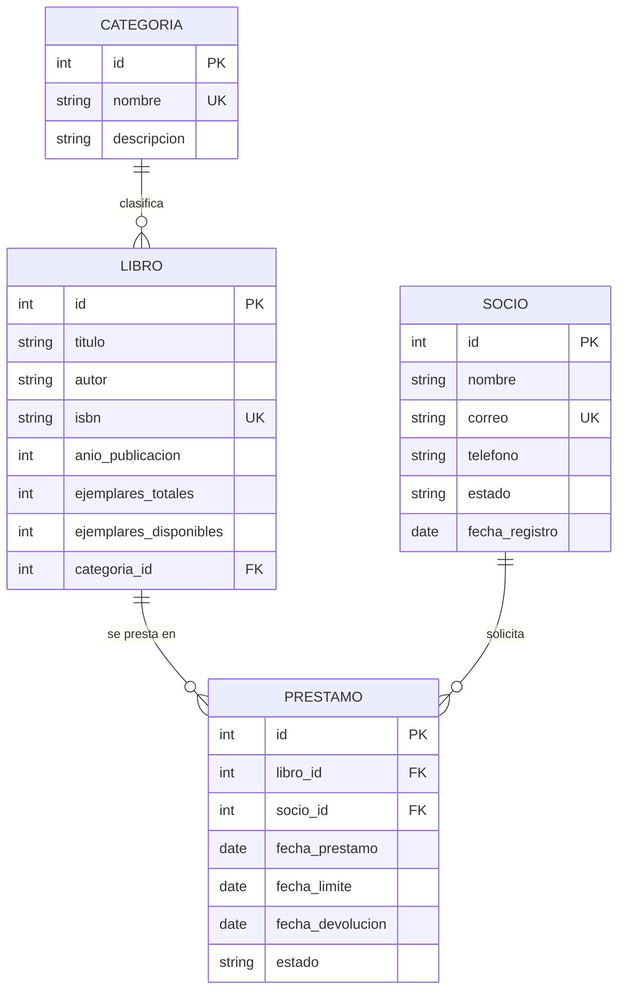

# Entregable 1: Diseño inicial

**Sistema:** Biblioteca Web
**Curso:** Desarrollo Web, LISTI (agosto 2026 - enero 2027)
**Equipo:** _[nombre del equipo]_
**Integrantes:** _[Integrante 1]_, _[Integrante 2]_, _[Integrante 3]_, _[Integrante 4]_
**Docente:** Dr. José Rafael Rojano Cáceres
**Repositorio:** `desarrollo-web` (_[enlace]_)

---

## 1. Descripción del sistema

Biblioteca Web es un sistema para administrar el catálogo de libros de una biblioteca, el registro de sus socios y el control de préstamos y devoluciones. Un bibliotecario puede dar de alta libros y categorías, registrar socios, prestar un libro a un socio, registrar su devolución y consultar qué préstamos están activos o vencidos.

## 2. Problemática que atiende

Muchas bibliotecas pequeñas (escolares, comunitarias o de departamento) llevan el control en cuadernos u hojas de cálculo. Esto provoca:

- No saber cuántos ejemplares de un libro están disponibles.
- Prestar un libro que ya no tiene ejemplares.
- Perder el rastro de quién tiene un libro y cuándo debía devolverlo.
- Duplicar registros de libros y de socios.
- Tardar en buscar un libro por título, autor o categoría.

## 3. Justificación

Un sistema web centraliza la información y aplica reglas automáticas (por ejemplo, no prestar sin ejemplares disponibles), con lo que reduce errores y tiempo de consulta. Además, es un dominio adecuado para el curso porque integra las tres capas con las tecnologías vistas: frontend (HTML, CSS, JavaScript con Fetch), backend (Java con Spring Boot) y base de datos relacional (MySQL con Hibernate/JPA). Tiene cuatro entidades con relaciones reales, por lo que el trabajo se reparte entre cuatro integrantes sin que ninguno quede con una carga trivial.

## 4. Requerimientos

### 4.1 Funcionales

| ID | Requerimiento |
|----|---------------|
| RF-01 | Crear, consultar, modificar y eliminar categorías. |
| RF-02 | Crear, consultar, modificar y eliminar libros. |
| RF-03 | Buscar libros por título, autor, categoría y disponibilidad. |
| RF-04 | Crear, consultar, modificar y eliminar socios. |
| RF-05 | Registrar un préstamo de un libro a un socio. |
| RF-06 | Registrar la devolución de un préstamo. |
| RF-07 | Consultar préstamos filtrando por socio y por estado (activo, devuelto, vencido). |
| RF-08 | Mostrar mensajes de error y confirmación en la interfaz. |

### 4.2 Reglas de negocio

| ID | Regla |
|----|-------|
| RN-01 | No se puede prestar un libro con 0 ejemplares disponibles. |
| RN-02 | Al registrar un préstamo, los ejemplares disponibles del libro disminuyen en 1; al devolverlo, aumentan en 1. |
| RN-03 | Un socio con estado SUSPENDIDO no puede recibir préstamos. |
| RN-04 | Un socio no puede tener más de 3 préstamos activos al mismo tiempo. |
| RN-05 | El ISBN del libro y el correo del socio son únicos. |
| RN-06 | No se puede eliminar una categoría con libros asociados, ni un libro o socio con préstamos activos. |
| RN-07 | La fecha límite de un préstamo es 7 días después de la fecha de préstamo. |
| RN-08 | Los ejemplares disponibles nunca pueden ser mayores a los totales ni menores a 0. |

### 4.3 No funcionales

| ID | Requerimiento |
|----|---------------|
| RNF-01 | El proyecto se desarrolla y ejecuta desde WSL. |
| RNF-02 | Arquitectura de 3 capas: frontend, backend (controlador, servicio, repositorio) y base de datos. |
| RNF-03 | La API devuelve JSON y códigos HTTP correctos (200, 201, 204, 400, 404, 409). |
| RNF-04 | El README permite reproducir el proyecto en otro entorno WSL. |

## 5. Arquitectura

```
Frontend (HTML + CSS + JavaScript)
        |   API Fetch / HTTP (JSON)
Backend (Java + Spring Boot: Controller -> Service -> Repository)
        |   Hibernate / JPA
Base de datos (MySQL)
```

## 6. Modelo de datos



Relaciones:

- Una categoría tiene muchos libros; un libro pertenece a una categoría (1:N).
- Un libro puede aparecer en muchos préstamos (1:N).
- Un socio puede tener muchos préstamos (1:N).
- Libro y Socio se relacionan de muchos a muchos a través de Préstamo.

Valores permitidos: `Socio.estado` = ACTIVO | SUSPENDIDO; `Prestamo.estado` = ACTIVO | DEVUELTO | VENCIDO.

El script completo está en `database/esquema.sql`.

## 7. Endpoints REST

Base URL: `http://localhost:8080/api`

### 7.1 Categorías

| Método | Ruta | Descripción | Respuestas |
|--------|------|-------------|------------|
| GET | `/categorias` | Lista todas las categorías | 200 |
| GET | `/categorias/{id}` | Consulta una categoría | 200, 404 |
| POST | `/categorias` | Crea una categoría | 201, 400, 409 |
| PUT | `/categorias/{id}` | Modifica una categoría | 200, 400, 404 |
| DELETE | `/categorias/{id}` | Elimina una categoría | 204, 404, 409 |

### 7.2 Libros

| Método | Ruta | Descripción | Respuestas |
|--------|------|-------------|------------|
| GET | `/libros` | Lista libros. Filtros opcionales: `?titulo=`, `?autor=`, `?categoriaId=`, `?disponible=true` | 200 |
| GET | `/libros/{id}` | Consulta un libro | 200, 404 |
| POST | `/libros` | Crea un libro | 201, 400, 409 |
| PUT | `/libros/{id}` | Modifica un libro | 200, 400, 404 |
| DELETE | `/libros/{id}` | Elimina un libro | 204, 404, 409 |

### 7.3 Socios

| Método | Ruta | Descripción | Respuestas |
|--------|------|-------------|------------|
| GET | `/socios` | Lista socios. Filtros opcionales: `?nombre=`, `?estado=` | 200 |
| GET | `/socios/{id}` | Consulta un socio | 200, 404 |
| POST | `/socios` | Crea un socio | 201, 400, 409 |
| PUT | `/socios/{id}` | Modifica un socio | 200, 400, 404 |
| DELETE | `/socios/{id}` | Elimina un socio | 204, 404, 409 |

### 7.4 Préstamos

| Método | Ruta | Descripción | Respuestas |
|--------|------|-------------|------------|
| GET | `/prestamos` | Lista préstamos. Filtros opcionales: `?socioId=`, `?estado=` | 200 |
| GET | `/prestamos/{id}` | Consulta un préstamo | 200, 404 |
| POST | `/prestamos` | Registra un préstamo (RN-01 a RN-04, RN-07) | 201, 400, 404, 409 |
| PUT | `/prestamos/{id}/devolucion` | Registra la devolución (RN-02) | 200, 404, 409 |
| PUT | `/prestamos/{id}` | Modifica un préstamo (por ejemplo, la fecha límite) | 200, 400, 404 |
| DELETE | `/prestamos/{id}` | Elimina un préstamo ya devuelto | 204, 404, 409 |

### 7.5 Ejemplos de JSON

Crear libro (`POST /api/libros`):

```json
{
  "titulo": "Cien años de soledad",
  "autor": "Gabriel García Márquez",
  "isbn": "9780307474728",
  "anioPublicacion": 1967,
  "ejemplaresTotales": 3,
  "categoriaId": 1
}
```

Registrar préstamo (`POST /api/prestamos`):

```json
{
  "libroId": 1,
  "socioId": 2
}
```

Error (formato común):

```json
{
  "status": 409,
  "mensaje": "No hay ejemplares disponibles del libro 1"
}
```

### 7.6 Ejemplos con CURL

```bash
curl -X POST http://localhost:8080/api/categorias \
  -H "Content-Type: application/json" \
  -d '{"nombre":"Novela","descripcion":"Narrativa de ficción"}'

curl http://localhost:8080/api/libros?titulo=cien

curl -X PUT http://localhost:8080/api/prestamos/1/devolucion
```

## 8. Estructura del backend

```
mx.uv.biblioteca
├── controller   (CategoriaController, LibroController, SocioController, PrestamoController)
├── service      (reglas de negocio)
├── repository   (interfaces JpaRepository)
├── model        (entidades JPA)
└── exception    (manejo de errores con @RestControllerAdvice)
```

## 9. Distribución de responsabilidades

Los nombres son un ejemplo para completar. Cada integrante escribe las pruebas de sus propios módulos y registra su uso de IA con su cuenta.

| Integrante | Responsabilidad principal | Entidades / módulos | Apoyo |
|------------|---------------------------|---------------------|-------|
| 1 | Backend de catálogo | Categoría y Libro (entidad, repositorio, servicio, controlador, filtros) | Esquema SQL |
| 2 | Backend de socios | Socio (CRUD, validaciones, unicidad de correo, estados) | Manejo global de errores |
| 3 | Backend de préstamos | Préstamo (alta, devolución, reglas RN-01 a RN-04, RN-07) | Pruebas CURL de integración |
| 4 | Frontend y documentación | HTML/CSS/JS con Fetch (formularios, tablas, mensajes), README, PDF | Configuración de CORS |

Todos participan en: el diseño de este entregable, la integración periódica entre módulos y el video final.

## 10. Plan de trabajo y control de versiones

- Un repositorio `desarrollo-web` con el webhook indicado por el profesor.
- Cada integrante usa su propia cuenta de GitHub y trabaja en su rama (`feature/catalogo`, `feature/socios`, `feature/prestamos`, `feature/frontend`).
- Cambios a `main` por pull request. Los commits describen cambios concretos.
- Un release por hito: `v0.1-diseno`, `v0.2-api-inicial`, `v0.3-api-completa`, `v0.4-integrado`, `v1.0-rc`.

| Hito | Contenido | Reporte |
|------|-----------|---------|
| Entregable 1 | Diseño, modelo de datos, endpoints y tareas | R1 (día 2) |
| Entregable 2 | API funcional inicial (POST y GET) y pruebas CURL | R2 (día 5) |
| Entregable 3 | API REST completa y persistencia | R3 (día 9) |
| Entregable 4 | Sistema integrado | |
| Entregable 5 | Versión candidata, pruebas y README | R4 (día 13) |
